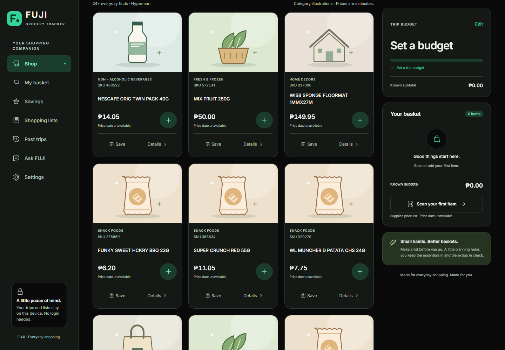

# FUJI grocery website and native Android app

Adds `/shopper/` alongside the existing cycle-count system and a native Kotlin/Compose Android companion. Both use **14,076 supplied items and prices** joined by exact SKU to HYPERMART: **14,026 matches and 50 explicitly unmatched items**. Only listed products are exported. The price list has no effective date; SKU 2028 is rounded from 0.209 to 0.21 pesos. Every estimate carries the required price-accuracy/cashier warning.

Web features include camera/manual lookup, offline catalog caching, exact centavo totals, basket budgets, lists, frozen-price trip history, a local catalog helper and a gated staff workspace. Startup loads a small starter and its prices; full search and prices load on demand. Optional cloud sync, online AI and staff publication remain disabled until configured.

Android uses Compose Material 3, MVVM/Repository, Hilt, Room, DataStore, Navigation and Coil. It supports offline search/scanning, basket budgets and shelf overrides, lists/favorites, saved trips and CSV sharing, private Photo Picker images, themes and source/privacy/credits. The APK has no internet permission, paid API, ads or analytics. Both apps share catalog provenance; personal shopping records stay separately on each device.

Web validation includes repository tests, syntax/type checks, production build, mobile shopping flow, offline lookup, scanner/QR round-trip, fixture-only savings and Firestore emulator isolation checks. Android validation and downloadable artifacts are produced by `.github/workflows/android.yml`; see `shopper-validation.md` for the final actual results.

The [Vercel website](https://fujisupersystem-git-codex-fuji-shopper-hypermart-fuji-92d1.vercel.app/shopper/) remains the **protected review preview selected by the user**, linked to [PR #2](https://github.com/danne6077-beep/CYCLE-COUNT1/pull/2). No production merge or paid hosting upgrade is performed.

The user subsequently requested a separate grocery website. Vercel project **fuji-grocery-tracker** now uses root directory `shopper`, sharing this repository's master files while excluding the Cycle Count Generator from its deployed pages. The redesign uses the supplied Scrnshts visual reference, original illustrated cards and self-hosted Inter.

