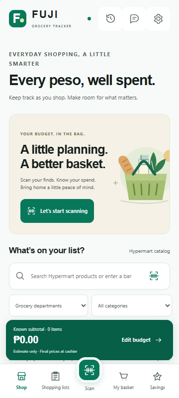
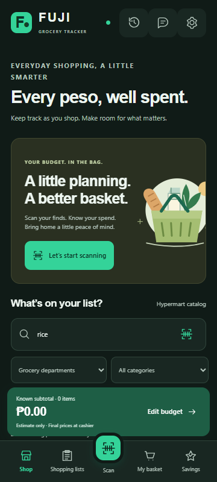

# Add a Hypermart grocery tracker with honest price estimates

Adds /shopper/ alongside the existing cycle-count system using only HYPERMART: 672,040 unique products. The sheet has no selling prices or verified net sizes. Missing prices stay explicit, private shelf-price entry supports a known subtotal, and the app warns: **Prices may not always be accurate. Estimate only. Final prices are confirmed at the cashier.**

Includes camera/manual barcode lookup, offline catalog caching, budgets/cart/list/trip workflows, exact-centavo totals, validated savings rules, a staff enrichment/publication workspace and optional gated server endpoints. Startup uses a 3.3 KB starter catalog; full department search loads when needed. Cloud sync, online AI and staff publication remain disabled until configured.

Validation: 57 repository tests, syntax lint, configured TypeScript checks, production build, mobile shopping flow, savings fixture, full offline catalog and shipped QR/ZXing round-trip checks pass. Firestore emulator isolation/security checks pass in [CI run 39204593995](https://github.com/danne6077-beep/CYCLE-COUNT1/actions/runs/39204593995). Lighthouse mobile: **Performance 97 / Accessibility 100** in [CI run 39204341645](https://github.com/danne6077-beep/CYCLE-COUNT1/actions/runs/39204341645). Physical camera checks and live optional cloud services are not claimed.

The protected [Vercel preview](https://fujisupersystem-git-codex-fuji-shopper-hypermart-fuji-92d1.vercel.app/shopper/) is connected to [PR #2](https://github.com/danne6077-beep/CYCLE-COUNT1/pull/2). It requires Vercel sign-in. The account is on Hobby, whose non-commercial restriction conflicts with a free store-owned launch. Production merge and any paid plan change remain pending that hosting decision. See shopper-validation.md and shopper/README.md for the exact verification scope and setup.
